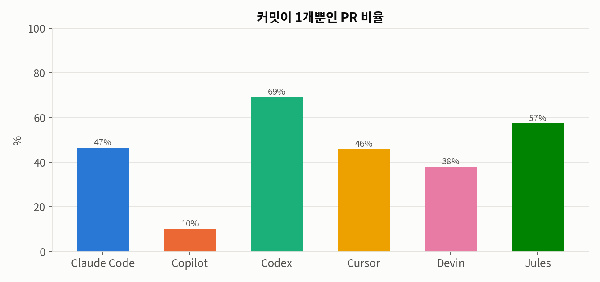
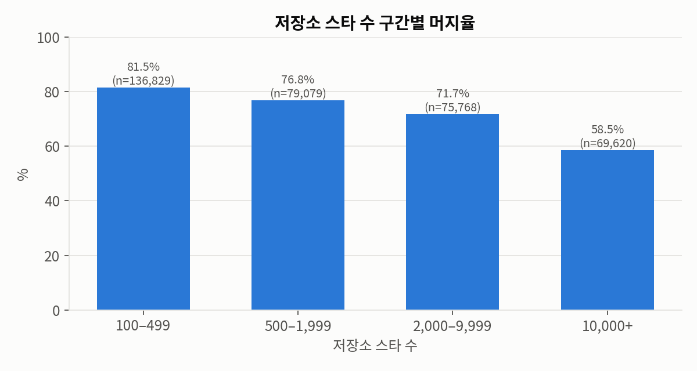
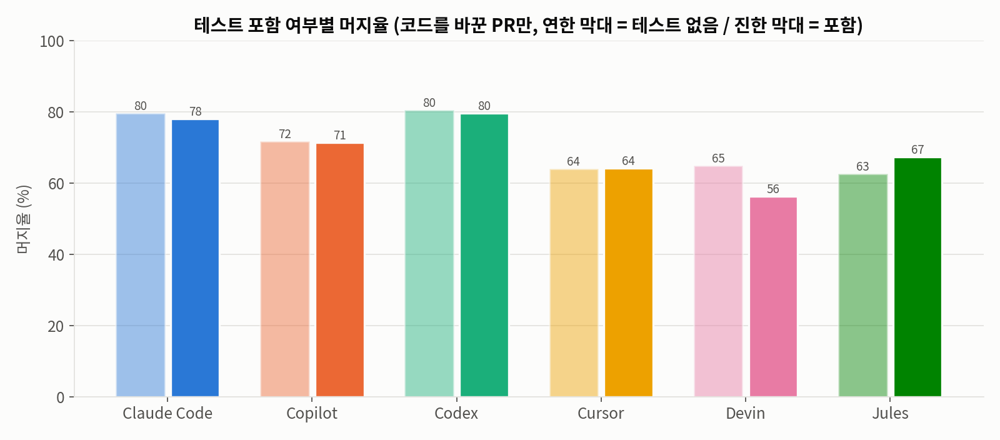
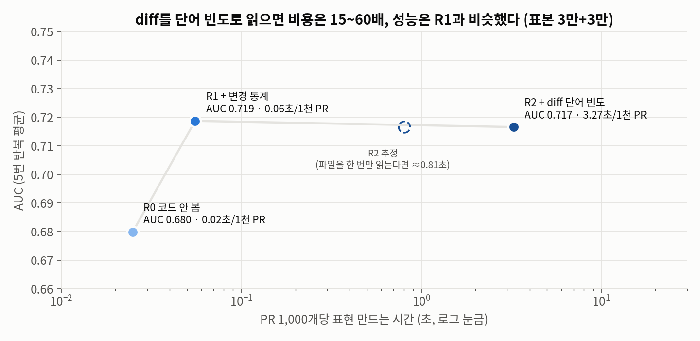

> **Blog-In-Progress (2026년 11월 24일 기준).** 데이터 처리, 탐색 분석, 코드 표현 R0~R2 실험까지 진행한 중간 결과다. 딥러닝 임베딩(R3)과 최종 분석은 12월 8일 최종본에서 완성한다.

**Members**

- 강현빈, 컴퓨터소프트웨어학부, 이메일
- 전성민, 컴퓨터소프트웨어학부, 이메일
- 정하랑, 컴퓨터소프트웨어학부, jungharang111@naver.com

**발표 영상:** (최종본에서 추가)

---

## I. Proposal {#proposal}

### Motivation: 왜 이 프로젝트를 하는가?

요즘 개발자들은 Claude Code, Codex, Copilot 같은 AI 코딩 에이전트에게 "이 버그 고쳐줘"라고 시키고, 에이전트는 코드를 고친 뒤 GitHub에 Pull Request(PR)를 올린다. 이렇게 AI가 올린 PR이 2026년 3월까지 공개 저장소에만 768만 개가 넘는다. AI는 PR을 사람보다 훨씬 빠르게 만들지만, 그 PR을 받아줄지(머지) 결정하는 건 여전히 사람이다.

그래서 이런 질문이 생긴다. **"이 PR, 열어보기 전에 받아들여질지 미리 알 수 있을까?"**

같은 데이터로 머지를 예측한 기존 연구들은 PR 크기나 저장소 정보 같은 숫자만 사용했다. 코드 내용을 직접 읽으면 더 잘 맞힐 수 있을지, 그 대신 처리 비용은 얼마나 드는지는 아직 정리된 결과가 없다.

### What do we want to see at the end?

1. 코드를 더 깊게 읽을수록(숫자 요약 → 단어 빈도 → 딥러닝 임베딩) 머지 예측은 얼마나 좋아지는가?
2. 그 대신 처리 시간과 메모리는 얼마나 늘어나는가? 어디까지가 가성비 구간인가?
3. 수백만 건 규모의 데이터를 어떤 방식으로 처리해야 현실적인가?

결과가 어느 쪽으로 나오든 **성능 대 비용** 그래프가 남는다는 점이 이 질문의 장점이다. 비싼 표현이 이기면 "비싸지만 가치가 있다", 비슷하면 "싼 표현으로 충분하다"가 결론이 된다.

---

## II. Datasets {#datasets}

### 데이터셋 소개: AIDev

[AIDev](https://huggingface.co/datasets/hao-li/AIDev-7.6M)는 AI 코딩 에이전트 6종이 GitHub에 올린 PR을 모은 공개 데이터셋이다(v5, 2026년 3월 31일 기준, CC-BY-4.0). 전체 768만 PR 중, 별 100개 이상 저장소만 모은 **AIDev-pop**은 리뷰·커밋·파일 변경까지 자세한 테이블을 제공한다. 우리는 AIDev-pop을 사용한다.

| 테이블 | 크기 | 내용 | 우리가 쓰는 곳 |
| --- | --- | --- | --- |
| `pull_request` | 362MB, 361,296행 | PR 제목·본문, 상태, 생성·머지 시각, 에이전트 | 라벨, R0 피처 |
| `repository` | 1.5MB, 25,402행 | 스타·포크 수, 언어 | R0 피처 |
| `pr_commits` | 341MB, 1,718,829행 | 커밋 단위 정보 | 커밋 수 분석 |
| `pr_commit_details` | **12.4GB**, 12,116,310행 | 커밋별 파일 변경과 diff(`patch`) | R1, R2 피처 |

- 기간: 2024년 12월 24일 ~ 2026년 3월 31일
- 닫힌 PR 332,406개 중 246,777개가 머지됐다(**74.2%**). 아직 열린 PR 28,890개는 결과를 모르므로 뺐다.
- 라벨: 머지됨 = 1, 머지 없이 닫힘 = 0
- `pr_commit_details`의 파일 변경 행 중 86.8%에 diff 본문이 있다. 나머지 13.2%(1,596,792행)는 비어 있다.

### 대용량 처리: pandas로는 안 된다

12.4GB 파일을 다루기 위해 먼저 처리 방식을 비교했다. 같은 집계를 세 가지 방식으로 실행하고, 실제 메모리 사용량(RSS)이 2.2GB를 넘으면 중단하도록 했다(메모리 3GB인 Linux 가상 환경).

| 테이블 | pandas 전체 읽기 | pandas 필요한 열만 | DuckDB |
| --- | --- | --- | --- |
| PR (362MB) | 실패 (2.2GB 초과) | 1.11초, 255MB | **0.08초, 44MB** |
| 파일 변경 (12.4GB) | 실패 (2.2GB 초과) | 1.66초, 1,090MB | **0.68초, 151MB** |

362MB짜리 PR 파일도 pandas로 통째로 읽으면 메모리가 터진다. PR 본문 같은 긴 텍스트가 메모리에서 몇 배로 부풀기 때문이다. Parquet는 열 단위로 저장돼서 필요한 열만 읽을 수 있고, DuckDB는 데이터를 전부 메모리에 올리지 않고 바로 쿼리한다. 그래서 이후 모든 전처리는 **Parquet + DuckDB**로 했다. 12.4GB 전체를 훑는 데 26초, R1 피처 생성은 8.5초가 걸렸다.

### 데이터 탐색

#### 1) 에이전트별 PR 수와 머지율

인기 저장소 기준으로는 Claude Code PR이 172,597개로 가장 많다. 머지율은 Codex(79.9%)와 Claude Code(78.8%)가 높고, Devin(61.9%)이 가장 낮다.

#### 2) 월별 PR 수

2025년 말부터 Claude Code PR이 급격히 늘었다. 2026년 3월 한 달에만 PR이 99,130개다. 데이터가 시간에 따라 크게 변하므로, 평가할 때 시간 순서를 지켜야 한다는 근거가 된다.

#### 3) 커밋이 1개뿐인 PR 비율

데이터에는 **커밋 시각이 없다.** 그래서 리뷰를 받고 나서 고친 커밋까지 diff에 섞일 수 있다. 커밋이 1개인 PR은 처음 올린 코드 그대로라서 이런 문제가 없다. 에이전트별로 Codex 69.2%, Claude Code 46.5%, Copilot 10.2%가 커밋 1개짜리 PR이다. 이 PR들만으로 따로 실험해 결과를 비교한다(III장).

#### 4) 저장소 인기도와 머지율

스타가 많은 저장소일수록 머지율이 낮다(100~499개 81.5% → 10,000개 이상 58.5%). 인기 저장소일수록 기준이 엄격하다는 뜻으로 보이며, 저장소 정보를 피처로 꼭 넣어야 하는 이유다.

#### 5) PR 크기와 테스트 포함률

변경 줄 수 중앙값은 Claude Code가 194줄로 가장 크고, Codex와 Jules가 117~118줄로 가장 작다. 테스트 파일을 함께 고친 PR 비율은 Codex가 50.8%로 가장 높다. 테스트 파일은 경로 규칙(`tests/`, `test_*`, `*_test.*`, `*.spec.*` 등)으로 판별했다.

#### 6) 테스트를 같이 짠 PR은 더 잘 머지될까?

코드를 실제로 바꾼 PR만 비교하면 테스트 포함 PR의 머지율은 75.7%, 미포함 PR은 76.3%로 **거의 같다.** 기존 연구([Haque et al., 2026](https://arxiv.org/abs/2601.03556))와 같은 결과다. 에이전트별로는 Devin만 테스트 포함 PR이 9%p 낮았다.

> 탐색 중 발견한 함정: 파일 변경이 하나도 없는 닫힌 PR이 8,119개 있었고(주로 Copilot), 머지율이 5.3%에 불과했다. 처음에는 이 PR들이 테스트 여부가 빈 값이라 그래프에서 조용히 빠져서 Copilot 숫자가 왜곡됐다. 테스트 비교에서는 이들을 제외하고, 그 사실을 명시했다.

---

## III. Methodology {#methodology}

### 실험 설계: 코드 표현만 바꾼다

같은 미래 PR(평가 세트)과 같은 분류기를 두고, **코드를 표현하는 방식만** 단계별로 바꿔가며 성능과 비용을 잰다. 차이가 생기면 표현 때문이라고 말할 수 있다.

| 단계 | 코드 표현 | 피처 | 상태 |
| --- | --- | --- | --- |
| R0 | 코드 안 봄 | 에이전트, 저장소 스타·포크·언어, 같은 저장소의 이전 PR 수, 제목·본문 길이, 제목 접두어로 뽑은 작업 종류 (8개) | 완료 |
| R1 | + 변경 통계 | 파일 수, 추가·삭제 줄 수, 확장자, 테스트 파일 포함 여부, 테스트 코드 비율, 문서 파일 비율 (17개) | 완료 |
| R2 | + diff 단어 빈도 | R1 + diff 텍스트 TF-IDF(어휘 35,923개)를 SVD로 128차원으로 줄인 값 (145개) | 표본 실험 완료 |
| R3 | + 딥러닝 임베딩 | R1 + diff를 CodeBERT에 넣어 뽑은 임베딩 | 진행 예정 |

### 분류기

모든 단계에 같은 XGBoost를 고정 설정으로 쓴다(트리 400개, 깊이 6, 학습률 0.08). 하이퍼파라미터를 표현마다 조정하지 않아서, 비교가 표현의 차이만 반영하도록 했다.

### 시간 분할 평가

데이터가 시간에 따라 크게 변하므로, 과거로 학습하고 미래로 평가한다.

| 세트 | 기간 | 닫힌 PR 수 | 머지율 |
| --- | --- | --- | --- |
| 학습 | 2025년 12월까지 | 143,702 | 72.8% |
| 검증 | 2026년 1월 | 40,930 | 73.4% |
| 평가 | 2026년 2~3월 | 147,774 | 75.9% |

비교를 위해 같은 개수로 무작위 분할한 결과도 함께 낸다. 기존 머지 예측 연구 일부는 무작위 분할만 썼기 때문이다.

### 평가 지표

- **AUC:** 머지된 PR과 거절된 PR을 무작위로 하나씩 뽑았을 때, 머지된 쪽에 더 높은 확률을 줄 가능성. 0.5면 동전 던지기다.
- **PR-AUC(거절 기준):** 소수 클래스인 거절 PR을 얼마나 잘 잡는지. 무작위로 찍으면 거절 비율(약 0.24)이 나온다.
- 정확도는 쓰지 않는다. 다 머지된다고 찍어도 76%가 나오기 때문이다.
- **비용:** 표현을 만드는 시간, 학습 시간, 예측 시간.

### 데이터 누수 막기

- 리뷰, 코멘트, CI 결과, 머지 시각처럼 PR이 열린 뒤 생기는 정보는 피처에서 뺐다.
- 같은 저장소의 이전 PR 수는 그 PR보다 먼저 만들어진 PR만 셌다.
- 커밋 시각이 없어서 리뷰 뒤 커밋이 diff에 섞일 수 있다. 그래서 **커밋 1개짜리 PR만으로 같은 실험**을 반복했다.
- 한계: 저장소 스타 수는 데이터 수집 시점 값이라, PR 시점보다 약간 미래 정보가 섞여 있다.

---

## IV. Evaluation & Analysis {#evaluation}

> 중간 결과다. R3(딥러닝 임베딩)와 틀린 사례 분석은 최종본에서 추가한다.

### 결과 1. 무작위 분할은 성능을 부풀린다

| 표현 | 시간 분할 AUC | 무작위 분할 AUC | 시간 분할 PR-AUC(거절) |
| --- | --- | --- | --- |
| R0 코드 안 봄 | 0.690 | 0.778 | 0.404 |
| R1 + 변경 통계 | **0.727** | 0.805 | **0.504** |
| R0, 커밋 1개 PR만 | 0.759 | 0.853 | 0.580 |
| R1, 커밋 1개 PR만 | 0.769 | 0.861 | 0.616 |

학습·평가 개수를 똑같이 맞췄는데도 무작위 분할의 AUC가 0.08~0.09 높다. 미래 PR이 학습에 섞이면서 실제보다 좋아 보이는 것이다. 무작위 분할로만 평가하면 성능을 과대평가하게 된다.

R0에서 R1로 가면 AUC가 0.690 → 0.727로 오르고, 거절 PR을 잡는 PR-AUC는 0.404 → 0.504로 크게 오른다. R1에서 가장 중요한 피처는 변경 규모(`log_churn`)와 에이전트 종류였다. 커밋 1개짜리 PR만 봐도 R1이 R0보다 높아서(0.759 → 0.769), 리뷰 뒤 커밋 때문에 생긴 효과만은 아닌 것으로 보인다.

### 결과 2. diff를 단어 빈도로 읽어도 나아지지 않았다

R2는 diff 본문을 직접 읽어야 해서 메모리 3GB 환경에서는 전체를 다룰 수 없었다. 그래서 학습 3만 개, 평가 3만 개를 같은 시간 분할 기준으로 뽑고, **같은 표본에서 R0, R1, R2를 모두 다시 돌려** 비교했다.

| 표현 | AUC | PR-AUC(거절) | PR 1,000개당 표현 생성 시간 |
| --- | --- | --- | --- |
| R0 | 0.680 | 0.390 | 0.006초 |
| R1 | **0.723** | **0.514** | 0.033초 |
| R2 | 0.716 | 0.502 | 3.22초 |

R2는 표현을 만드는 데 R1보다 약 100배 오래 걸렸지만(diff 추출 177초, TF-IDF 11.5초, SVD 2.4초), 성능은 오히려 조금 낮았다. 숫자로 요약한 변경 통계가 이미 대부분의 신호를 잡고 있고, 단어 빈도 128차원은 신호보다 잡음을 더 많이 더한 것으로 보인다. 이 결과는 리뷰 부담 예측에서 텍스트 표현이 구조적 피처를 못 이겼다는 선행 연구([Minh et al., MSR 2026](https://arxiv.org/html/2601.00753v2))와도 맞는다.

**주의할 점**

- R2의 표현 생성 시간에는 12.4GB 파일을 1만 개씩 6번 나눠 읽은 시간이 포함돼 있어서 실제보다 크게 잡혔을 수 있다.
- 2026년 3월 PR은 아직 열린 비율이 13.5%라서, 평가 세트가 빨리 닫힌 PR 쪽으로 치우쳤을 수 있다.

### 남은 실험 (최종본)

- **R3:** diff를 CodeBERT에 넣어 임베딩을 뽑고, 같은 표본에서 R0~R2와 비교한다. 딥러닝이 단어 빈도와 달리 신호를 잡는지 확인한다.
- **규모 곡선:** 데이터 1만 · 10만 · 전체에서 표현별 처리 시간이 어떻게 늘어나는지 잰다.
- **틀린 사례 분석:** 모델이 확신했는데 틀린 PR 몇 개를 직접 열어본다.
- (선택) TF-IDF + 로지스틱 회귀처럼 텍스트에 더 맞는 결합 방식으로 R2를 다시 시험한다.

---

## V. Related Work {#related-work}

### 기존 연구

| 연구 | 한 것 | 우리와의 차이 |
| --- | --- | --- |
| [Reliable Mining of Heterogeneous AI Coding-Agent Data](https://arxiv.org/abs/2611.20297) (2026.11) | PR 71,677개로 머지 예측. 시간 분할에서 성능 하락을 보고 | 숫자 피처만 사용. 코드 내용, 처리 비용은 다루지 않음 |
| [Predicting Acceptance and Review Effort in Human and Agent PRs](https://arxiv.org/pdf/2607.12057) (2026.07) | 고전 ML로 머지 예측(AUC 0.676) | 무작위 교차검증만 사용, 딥러닝 없음 |
| [Early-Stage Prediction of Review Effort in AI-Generated PRs](https://arxiv.org/html/2601.00753v2) (MSR 2026) | 리뷰 부담 예측. CodeBERT가 구조적 피처를 못 이김 | 머지가 아닌 리뷰 부담, 처리 시간 측정 없음 |
| [Do Autonomous Agents Contribute Test Code?](https://arxiv.org/abs/2601.03556) (2026.01) | 테스트 포함 여부와 머지율이 비슷함 | 통계 분석만, 예측 모델 없음 |
| [Comparing AI Coding Agents](https://arxiv.org/html/2602.08915v1) (MSR 2026) | 에이전트별 수용률 비교 | 예측 모델 없음 |

### 사용한 도구와 라이브러리

- 데이터: [AIDev-7.6M (Hugging Face)](https://huggingface.co/datasets/hao-li/AIDev-7.6M)
- 처리: DuckDB 1.5, Apache Parquet(pyarrow), pandas
- 모델: XGBoost 3.2, scikit-learn(TF-IDF, TruncatedSVD, 평가 지표)
- 시각화: matplotlib
- 예정: Hugging Face Transformers(CodeBERT)

---

## VI. Conclusion {#conclusion}

### 중간 정리

- **대용량 처리:** 12.4GB 데이터는 pandas로 통째로 다룰 수 없었고, Parquet + DuckDB로는 필요한 열만 읽어 1초 안에 집계할 수 있었다.
- **평가 방식:** 무작위 분할은 AUC를 0.08~0.09 부풀렸다. 시간 순서로 평가해야 실제 성능을 볼 수 있다.
- **코드 표현:** 변경 통계(R1)는 적은 비용으로 성능을 올렸지만, diff 단어 빈도(R2)는 약 100배 비용을 쓰고도 나아지지 않았다. 딥러닝 임베딩(R3)이 이 구도를 바꾸는지가 최종본의 핵심 질문이다.
- **테스트:** 테스트를 같이 짠 PR이 더 잘 머지되지는 않았다.

### 역할 분담

- 강현빈: (담당 업무)
- 전성민: (담당 업무)
- 정하랑: (담당 업무)
