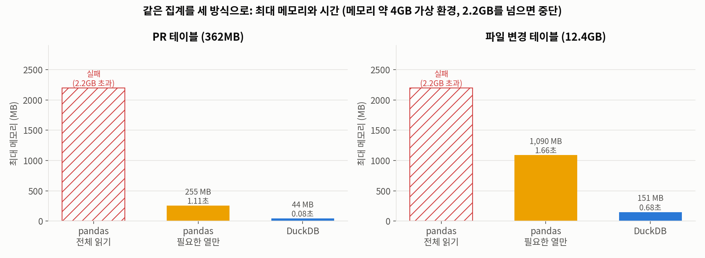
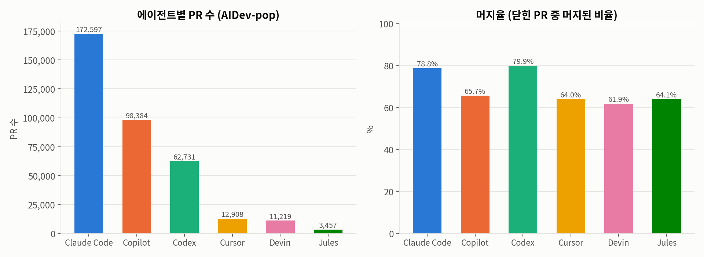
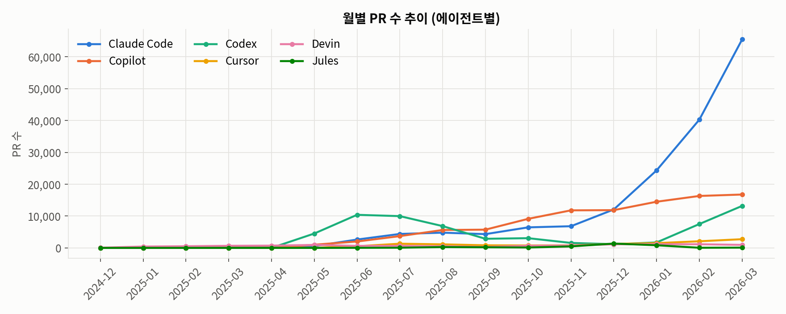
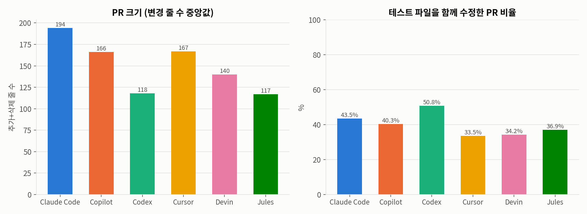
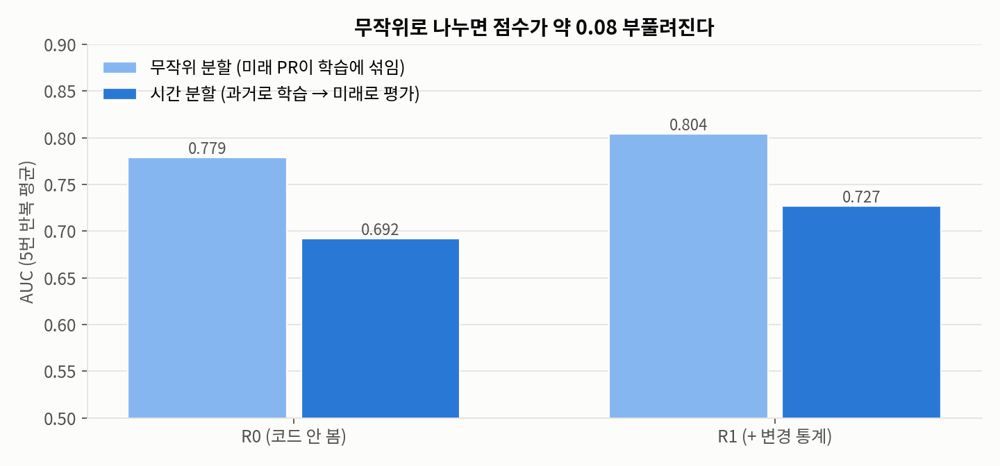

> **Blog-In-Progress (2026년 11월 24일 기준).** 데이터 준비, 탐색, 코드 표현 R0~R2 실험까지 진행한 중간 결과다. 딥러닝 임베딩(R3)과 최종 결론은 12월 8일 최종본에서 채운다.

**Members**

- 강현빈, 컴퓨터소프트웨어학부, 이메일
- 전성민, 컴퓨터소프트웨어학부, 이메일
- 정하랑, 컴퓨터소프트웨어학부, jungharang111@naver.com

**발표 영상:** (최종본에서 추가)

**이 글을 읽는 법:** 어려운 단어는 처음 나올 때 쉬운 말로 풀었고, 맨 끝 [용어 사전](#glossary)에도 모아 두었다. 각 장 첫머리의 "한 줄 요약"만 읽어도 전체 흐름을 따라갈 수 있다. 실험 코드와 결과 숫자 파일은 [저장소의 `code` 폴더](https://github.com/aix-dl-team/aix-deeplearning-final/tree/main/code)에 있다.

---

## I. Proposal {#proposal}

**한 줄 요약:** AI가 올린 코드 수정 제안이 받아들여질지 미리 맞혀 보고, 코드를 얼마나 깊이 읽어야 잘 맞히는지, 그 대신 시간이 얼마나 드는지 잰다.
{: .summary}

### Motivation: 왜 이 프로젝트를 하는가?

요즘은 사람이 직접 코드를 고치는 대신 AI에게 "이 버그 고쳐줘"라고 시키는 일이 많다. 이렇게 코드를 대신 고쳐 주는 Claude Code, Codex, Copilot 같은 프로그램을 **AI 코딩 에이전트**라고 부른다. 에이전트는 코드를 고친 뒤 GitHub(전 세계 개발자가 코드를 모아 두는 사이트)에 "이렇게 고쳤으니 반영해 주세요"라는 제안을 올린다. 이 제안이 **PR(Pull Request)**이다.

PR은 학교 숙제와 비슷하다. 학생(에이전트)이 숙제(PR)를 내면, 선생님(프로젝트 관리자)이 검사해서 통과시키거나 돌려보낸다. 통과돼서 실제 코드에 합쳐지는 것을 **머지(merge)**라고 한다.

AI가 올린 PR은 우리가 쓴 데이터셋이 2026년 3월까지 공개 저장소에서 모은 것만 해도 약 768만 개다. AI는 PR을 사람보다 훨씬 빨리 만들지만, 통과시킬지 정하는 건 여전히 사람이다. 검사해야 할 PR이 너무 많아진 것이다. 그래서 이런 질문을 했다.

**"이 PR, 열어 보기 전에 통과될지 미리 알 수 있을까?"**

미리 알 수 있다면 통과 가능성이 낮은 PR을 먼저 꼼꼼히 보는 식으로 검사 순서를 정할 수 있다. 우리가 찾아본 기존 머지 예측 연구는 PR 크기, 저장소 정보 같은 **겉정보** 위주였다. 코드 내용을 얼마나 깊이 읽느냐에 따라 예측이 얼마나 좋아지는지, 그 대신 처리 시간이 얼마나 늘어나는지를 같은 조건에서 함께 잰 연구는 찾지 못했다([V장](#related-work) 참고).

### What do we want to see at the end?

1. 코드를 더 깊이 읽을수록(숫자로 요약 → 단어 세기 → 딥러닝) 예측은 얼마나 좋아지는가?
2. 그 대신 시간과 메모리는 얼마나 더 드는가? 어디까지가 "들인 만큼 좋아지는" 구간인가?
3. 수백만 줄짜리 데이터를 평범한 컴퓨터에서 다루려면 어떻게 해야 하는가?

결과가 어느 쪽으로 나와도 쓸모가 있다. 비싼 방법이 이기면 "비싸도 쓸 만하다", 비슷하면 "싼 방법으로 충분하다"가 답이 된다.

---

## II. Datasets {#datasets}

**한 줄 요약:** 인기 저장소에 AI가 올린 PR 36만 개를 썼다. 가장 큰 파일이 12.4GB라서 흔히 쓰는 도구(pandas)로는 열리지도 않았고, DuckDB라는 도구로 해결했다.
{: .summary}

### 데이터셋 소개: AIDev

[AIDev](https://huggingface.co/datasets/hao-li/AIDev-7.6M)는 AI 코딩 에이전트 6종(Claude Code, Codex, Copilot, Cursor, Devin, Jules)이 GitHub에 올린 PR을 모은 공개 데이터셋이다([Li 외, 2025](https://arxiv.org/abs/2507.15003); [Li 외, MSR 2026](https://arxiv.org/abs/2602.09185)). 우리는 2026년 3월 31일까지 모은 v5 버전을 썼다. 전체 PR은 7,685,281개이고, 라이선스는 CC BY 4.0(출처를 밝히면 자유롭게 쓸 수 있음)이다.

이 중 **별**(GitHub의 "좋아요")을 100개 넘게 받은 저장소만 모은 묶음을 **AIDev-pop**이라고 부른다. 커밋, 파일 변경, 리뷰 같은 자세한 정보는 이 묶음에만 있어서 AIDev-pop을 썼다.

| 테이블 | 크기 | 들어 있는 것 | 우리가 쓴 곳 |
| --- | --- | --- | --- |
| `pull_request` | 362MB, 361,296행 | PR 제목·본문, 상태, 만든 시각, 머지 시각, 에이전트 이름 | 정답(머지 여부), R0 |
| `repository` | 1.5MB, 25,402행 | 저장소의 별·포크 수, 프로그래밍 언어 | R0 |
| `pr_commits` | 341MB, 1,718,829행 | 커밋 목록 | 커밋 수 분석 |
| `pr_commit_details` | **12.4GB**, 12,116,310행 | 커밋마다 바뀐 파일과 바뀐 내용(diff) | R1, R2 |

**커밋**은 "코드를 고친 뒤 한 번 저장한 기록"이고, **diff**는 "어느 줄을 지우고 어느 줄을 넣었는지 보여 주는 변경 내역"이다. **포크**는 남의 저장소를 복사해 간 횟수다.

- 기간: 2024년 12월 24일 ~ 2026년 3월 31일 (저장소 25,402개, PR 361,296개)
- 이미 끝난(닫힌) PR 332,406개 중 246,777개가 머지됐다(**74.2%**). 아직 검사 중인(열린) PR 28,890개는 결과를 모르기 때문에 뺐다.
- 정답(라벨): 머지됨 = 1, 머지 없이 닫힘 = 0
- 파일 변경 기록 12,116,310행 중 13.2%(1,596,792행)는 diff 내용이 비어 있다.

### 대용량 처리: pandas로는 안 된다

데이터가 커서 먼저 "어떤 도구로 읽을지"부터 실험했다. 같은 계산을 세 가지 방법으로 해 보고, **메모리**(컴퓨터가 작업하는 동안 쓰는 책상 공간)를 얼마나 쓰는지 쟀다. 실험한 컴퓨터는 메모리가 약 4GB인 리눅스 가상 환경이었고, 메모리를 2.2GB 넘게 쓰면 실패로 보고 멈췄다.

- PR 테이블에서 한 계산: 에이전트별 머지율
- 파일 변경 테이블에서 한 계산: PR마다 추가·삭제한 줄 수 합계

**그래프에서 볼 것:** 빨간 빗금 막대는 "메모리가 넘쳐서 실패"다. 파란 막대(DuckDB)는 거의 바닥에 붙어 있다.
{: .figcap}

| 테이블 | pandas로 전부 읽기 | pandas로 필요한 칸만 | DuckDB |
| --- | --- | --- | --- |
| PR (362MB) | 실패 (2.2GB 초과) | 1.11초, 255MB | **0.08초, 44MB** |
| 파일 변경 (12.4GB) | 실패 (2.2GB 초과) | 1.66초, 1,090MB | **0.68초, 151MB** |

PR 테이블은 3번 재서 가운데 값, 파일 변경 테이블은 1번 잰 값이다.

**왜 이렇게 차이가 날까?** pandas는 파일을 통째로 메모리에 올린 뒤 계산한다. 362MB짜리 PR 파일도 긴 PR 본문 글이 메모리 안에서 몇 배로 커지면서 넘친 것으로 보인다. 반면 우리 데이터 형식인 **Parquet**는 칸(열)별로 따로 저장돼 있어서 필요한 칸만 꺼낼 수 있고, **DuckDB**는 데이터를 조금씩 읽으면서 바로 계산한다. 도서관 책을 전부 집에 들고 오는 대신, 필요한 쪽만 그 자리에서 읽고 메모하는 것과 비슷하다.

그래서 이후 모든 전처리는 Parquet + DuckDB로 했다. diff 내용까지 12.4GB 전체를 한 번 훑는 데 약 30초, R1 피처를 만드는 데 약 10~15초가 걸렸다.

### 데이터 탐색

#### 1) 에이전트별 PR 수와 머지율

**그래프에서 볼 것:** 왼쪽은 "얼마나 많이 냈나", 오른쪽은 "얼마나 통과됐나"다. 많이 낸다고 통과율이 높은 건 아니다.
{: .figcap}

Claude Code가 172,597개로 가장 많이 냈다. **머지율**(닫힌 PR 중 머지된 비율)은 Codex 79.9%, Claude Code 78.8%가 높고, Devin이 61.9%로 가장 낮다.

#### 2) 월별 PR 수

**그래프에서 볼 것:** 파란 선(Claude Code)이 2025년 12월부터 가파르게 올라간다.
{: .figcap}

Claude Code PR은 2025년 12월 12,057개에서 2026년 3월 65,436개로, 석 달 만에 5배 넘게 늘었다. 2026년 3월 한 달 동안 올라온 PR은 모두 99,130개다. 이렇게 데이터가 시간에 따라 크게 바뀌기 때문에, 모델을 평가할 때도 "과거로 배우고 미래로 시험 보기"를 지켜야 한다([III장](#methodology)).

#### 3) 커밋이 1개뿐인 PR 비율

이 데이터에는 커밋을 **언제** 했는지 시각이 없다. 그래서 검사를 받은 뒤 고쳐서 다시 저장한 커밋까지 diff에 섞여 있을 수 있다. 시험이 끝난 뒤 고친 답안지로 채점하는 것과 비슷해서, 예측이 실제보다 쉬워질 수 있다. 커밋이 1개인 PR은 처음 올린 코드 그대로일 가능성이 높아서 이 문제가 적다. 다만 커밋을 덮어써서 1개로 만든 경우까지는 구별할 수 없다.

커밋 1개짜리 PR 비율은 Codex 69.2%, Jules 57.3%, Claude Code 46.5%, Cursor 45.9%, Devin 38.1%, Copilot 10.2%다. 이 PR들만으로 실험을 한 번 더 했다([IV장](#evaluation)).

#### 4) 저장소 인기도와 머지율

**그래프에서 볼 것:** 오른쪽(별이 많은 저장소)으로 갈수록 막대가 낮아진다.
{: .figcap}

별이 많은 저장소일수록 머지율이 낮다(별 101~499개 81.5% → 10,000개 이상 58.5%). 에이전트별로 나눠 봐도 6종 모두 별 10,000개 이상 구간의 머지율이 가장 낮았다. 인기 프로젝트일수록 검사 기준이 까다롭기 때문일 수 있지만, 이 데이터만으로 원인을 단정할 수는 없다. AIDev의 더 넓은 범위(별이 없는 저장소까지 포함)를 분석한 다른 연구([Bhavnagri, 2026](https://www.ijraset.com/best-journal/ai-coding-agents-on-github-repository-popularity-as-a-hidden-confounder-in-the-acceptance-of-2-million-agentauthored-pull-requests))도 "인기 저장소일수록 머지율이 낮고, 에이전트별로 나눠도 같다"는 결과를 냈다. 그래서 저장소 정보를 예측 재료로 꼭 넣었다.

#### 5) PR 크기와 테스트 포함률

파일 변경 기록이 있는 닫힌 PR 322,889개로 셌다. 바꾼 줄 수(추가+삭제)의 **중앙값**(크기순으로 줄 세웠을 때 한가운데 값)은 Claude Code가 194줄로 가장 크고, Codex(118줄)와 Jules(117줄)가 가장 작다.

**테스트**는 "코드가 제대로 동작하는지 자동으로 확인하는 코드"다. 테스트 파일을 함께 고친 PR 비율은 Codex가 50.8%로 가장 높고, Copilot 44.2%, Claude Code 43.5% 순이다. 테스트 파일은 파일 경로 규칙(`tests/` 폴더 안, `test_`로 시작, `_test.`나 `.spec.`가 들어간 이름 등)으로 골랐다.

#### 6) 테스트를 같이 짠 PR은 더 잘 머지될까?

**그래프에서 볼 것:** 같은 색의 연한 막대(테스트 없음)와 진한 막대(테스트 포함)가 거의 같은 높이다. Devin만 진한 막대가 눈에 띄게 낮다.
{: .figcap}

기대와 달리 거의 차이가 없었다. 테스트를 포함한 PR의 머지율은 75.7%, 포함하지 않은 PR은 76.3%다. 에이전트별로도 대부분 2%p(퍼센트포인트) 안쪽 차이였고, Devin만 테스트를 포함한 PR이 8.6%p 낮았다(56.3% 대 64.9%). Jules는 반대로 4.8%p 높았다. 예전 버전의 AIDev를 분석한 [Haque 외(2026)](https://arxiv.org/abs/2601.03556)도 "머지율은 대체로 비슷하고 Devin만 예외"라는 같은 결론을 냈다.

**탐색 중 발견한 함정.** 닫힌 PR 중 8,119개는 파일 변경 기록이 비어 있었고(그중 7,982개가 Copilot), 머지율이 5.3%밖에 안 됐다. 처음에는 이 PR들이 "테스트 없음"으로 계산돼서 Copilot 숫자가 틀어졌다. 그래서 크기와 테스트 비교에서는 이 PR들을 뺐다. 또 닫힌 PR 1,398개(그중 1,273개가 Claude Code)는 파일 변경 기록이 아예 없어서 모델 실험에서 뺐다.
{: .note}

---

## III. Methodology {#methodology}

**한 줄 요약:** 시험 문제(평가할 PR)와 채점하는 프로그램(분류기)은 그대로 두고, 코드를 읽는 방법만 4단계로 바꿔 가며 점수와 시간을 비교한다.
{: .summary}

### 실험 설계: 코드 표현만 바꾼다

컴퓨터는 글이나 코드를 그대로 이해하지 못하고 **숫자**만 다룰 수 있다. 그래서 PR 하나를 숫자 여러 개로 바꿔야 한다. 이 숫자 하나하나를 **피처**(특징), PR을 숫자로 바꾸는 방법을 **표현**이라고 부른다.

공정하게 비교하려고 평가할 PR과 분류기는 그대로 두고 표현만 바꿨다. 결과가 달라지면 표현 때문이라고 말할 수 있다. 과학 시간에 배우는 "변인 통제"와 같은 생각이다.

| 단계 | 쉽게 말하면 | 실제로 넣은 것 | 피처 수 | 상태 |
| --- | --- | --- | --- | --- |
| R0 | 코드는 안 보고 겉정보만 | 에이전트, 저장소의 별·포크 수와 언어, 같은 저장소에 그전까지 올라온 AI PR 수, 제목·본문 길이, 제목 첫 단어로 알아낸 작업 종류(fix, feat 등) | 8 | 완료 |
| R1 | + 바뀐 코드를 숫자로 요약 | R0 + 바꾼 파일 수, 추가한 줄 수, 삭제한 줄 수, 전체 바꾼 줄 수(로그 값), 파일 확장자 종류 수, 가장 많이 바꾼 확장자, 테스트 파일 포함 여부, 바꾼 줄 중 테스트 비율, 문서 파일 비율 | 17 | 완료 |
| R2 | + 코드에 나온 단어 세기 | R1 + diff에 나온 단어(변수·함수 이름 등)를 TF-IDF로 점수 매긴 뒤 SVD로 128개 숫자로 압축 | 145 | 표본 실험 완료 |
| R3 | + 딥러닝으로 코드 뜻 읽기 | R1 + diff를 CodeBERT에 넣어 뽑은 숫자 | 미정 | 진행 예정 |

R2에서 쓴 두 방법을 쉽게 풀면 이렇다.

- **TF-IDF:** 단어마다 점수를 매기는 방법이다. 모든 PR에 흔히 나오는 단어(예: `if`, `return`)는 낮게, 이 PR에서만 자주 나오는 단어는 높게 친다.
- **SVD:** 3만 개가 넘는 단어 점수를, 함께 자주 나오는 것끼리 묶어서 128개 숫자로 줄이는 방법이다. 긴 글을 몇 줄로 요약하는 것과 비슷하다.

diff는 파일 변경 하나당 앞 1,500자, PR 하나당 최대 6,000자까지만 썼다. 단어 사전에는 35,923개 단어가 들어갔다.

R3에서 쓸 **CodeBERT**는 수많은 코드를 미리 읽고 공부한 AI 모델이다. 코드를 넣으면 그 뜻을 담은 숫자 목록(**임베딩**)을 돌려준다.

### 분류기

**분류기**는 피처를 보고 "머지될 확률"을 계산하는 프로그램이다. 모든 단계에서 같은 **XGBoost**를 같은 설정(결정 트리 400개, 깊이 6, 학습률 0.08)으로 썼다. XGBoost는 스무고개처럼 "바꾼 줄이 500줄보다 많은가?" 같은 질문을 이어 가는 나무(결정 트리)를 수백 개 만들고, 그 답을 모아 확률을 낸다.

표현마다 설정을 따로 맞추지 않았기 때문에, 점수 차이는 표현 차이에서만 나온다. 또 XGBoost는 배울 때 데이터를 무작위로 골라 쓰는 부분이 있어서, 같은 실험도 돌릴 때마다 점수가 조금씩 달라진다. 그래서 무작위의 출발점(난수 시드)만 바꿔 **5번씩 반복**하고 평균을 냈다.

### 시간 분할 평가

작년 기출문제로 공부하고 올해 시험을 보는 것처럼, **과거 PR로 배우고 미래 PR로 평가**한다.

| 세트 | 기간 | 닫힌 PR 수 | 머지율 | 쓰임 |
| --- | --- | --- | --- | --- |
| 학습 | 2024년 12월 ~ 2025년 12월 | 143,239 | 72.8% | 모델이 공부하는 문제 |
| 검증 | 2026년 1월 | 40,794 | 73.5% | 이번엔 쓰지 않음 (설정을 고정해서 따로 맞출 것이 없었다) |
| 평가 | 2026년 2~3월 | 146,975 | 76.0% | 시험 문제 |

위 숫자는 파일 변경 기록이 있는 닫힌 PR 기준이다.

비교를 위해 **무작위 분할**도 했다. 같은 PR 전체를 섞은 뒤, 학습·평가 개수를 위 표와 똑같이 맞춰 나눴다. 기존 머지 예측 연구 중에는 시간 순서를 나누지 않고 평가한 경우가 있어서([Pansuriya 외, 2026](https://arxiv.org/pdf/2607.12057)), 두 방법이 얼마나 다른지 확인하려는 것이다.

### 평가 지표

- **정확도(맞힌 비율)는 쓰지 않는다.** 평가 PR의 76%가 머지돼서, 무조건 "머지된다"고만 찍어도 정확도가 76%나 나오기 때문이다.
- **AUC:** 머지된 PR 하나와 거절된 PR 하나를 무작위로 골라 보여 줬을 때, 모델이 머지된 쪽에 더 높은 확률을 줄 가능성이다. 0.5면 동전 던지기 수준, 1.0이면 항상 맞힌다.
- **PR-AUC(거절 기준):** 거절될 PR을 골라내는 능력이다. 무작위로 찍으면 거절 비율(약 0.24)과 같은 값이 나오므로, 0.24보다 얼마나 높은지를 본다.
- **비용:** 표현을 만드는 시간(PR 1,000개당 초), 학습 시간, 예측 시간.

### 데이터 누수 막기

**데이터 누수**는 시험 중에 답을 엿보는 것처럼, 실제로 예측할 때는 알 수 없는 정보가 모델에 들어가는 것이다. 누수가 있으면 점수가 실제보다 좋게 나온다.

- 리뷰, 댓글, 자동 검사(CI) 결과, 머지 시각처럼 PR이 올라간 **뒤에** 생기는 정보는 넣지 않았다.
- "같은 저장소에 그전까지 올라온 AI PR 수"는 그 PR보다 먼저 만들어진 PR만 셌다.
- 커밋 시각이 없어서 검사 뒤에 고친 코드가 diff에 섞일 수 있다. 그래서 커밋 1개짜리 PR만으로 같은 실험을 따로 했다.
- 남은 한계: 저장소의 별·포크 수는 데이터를 모은 시점의 값이라, PR을 올린 시점보다 조금 미래의 정보가 섞여 있다.

---

## IV. Evaluation & Analysis {#evaluation}

> 중간 결과다. R3(딥러닝 임베딩)와 틀린 사례 분석은 최종본에서 추가한다.

**한 줄 요약:** ① 무작위로 나눠서 평가하면 점수가 0.08~0.10 부풀려진다. ② 바뀐 코드를 숫자로 요약(R1)하면 점수가 확실히 오른다. ③ 코드에 나온 단어를 세는 방법(R2)은 시간을 15~60배 더 쓰고도 R1보다 나아지지 않았다.
{: .summary}

### 결과 1. 무작위로 나누면 성능이 부풀려진다

**그래프에서 볼 것:** 연한 막대(무작위 분할)와 진한 막대(시간 분할)의 높이 차이가 "부풀려진 만큼"이다.
{: .figcap}

| 표현 | 시간 분할 AUC | 무작위 분할 AUC | 부풀려진 정도 | 시간 분할 PR-AUC(거절) |
| --- | --- | --- | --- | --- |
| R0 코드 안 봄 | 0.692 (0.688~0.699) | 0.779 | +0.09 | 0.405 |
| R1 + 변경 통계 | **0.727** (0.722~0.731) | 0.804 | +0.08 | **0.505** |
| R0, 커밋 1개 PR만 | 0.755 (0.748~0.763) | 0.854 | +0.10 | 0.572 |
| R1, 커밋 1개 PR만 | 0.768 (0.760~0.775) | 0.864 | +0.10 | 0.617 |

숫자는 5번 반복한 평균이고, 괄호 안은 5번 중 가장 낮은 값과 높은 값이다. 전체 실험의 평가 PR은 146,975개(거절 비율 24.0%), 커밋 1개 실험은 58,741개다.

**무작위 분할은 점수를 부풀린다.** 학습·평가 개수를 똑같이 맞췄는데도 무작위로 나눈 쪽의 AUC가 0.08~0.10 높다. 무작위로 섞으면 평가할 PR과 같은 시기, 같은 저장소의 PR이 학습에도 들어간다. 모델이 "요즘 이 저장소는 PR을 잘 받아 준다" 같은 미래의 정보를 미리 배우는 셈이어서 실제보다 좋아 보이는 것으로 해석된다. 실제로 쓸 때는 언제나 아직 오지 않은 PR을 예측해야 하므로, 시간 분할 점수가 진짜 실력에 가깝다.

**코드를 숫자로 요약하면(R1) 확실히 좋아진다.** AUC는 0.692에서 0.727로 0.035 올랐고, 거절 PR을 골라내는 점수(PR-AUC)는 0.405에서 0.505로 올랐다. 아무렇게나 찍었을 때(0.24)의 약 2배다. 5번 반복 모두 R1이 높았고(+0.030~+0.041), 평가 PR을 무작위로 다시 뽑아 여러 번 계산해 보는 방법(**부트스트랩**)으로 구한 95% 범위도 +0.032~+0.036으로 0보다 확실히 크다. R1에서 예측에 가장 크게 기여한 피처는 전체 바꾼 줄 수와 에이전트 종류였다.

커밋 1개짜리 PR만 봐도 R1이 R0보다 높았다(0.755 → 0.768, 5번 모두 R1이 높음). 그래서 R1의 효과가 "검사 뒤에 고친 커밋" 때문만은 아닌 것으로 보인다. 다만 올라간 폭은 0.035에서 0.014로 줄었다.

### 결과 2. diff 단어를 세도 나아지지 않았다

R2는 diff 글자를 직접 다뤄야 해서, 메모리 4GB 환경에서는 전체(약 29만 개)를 한꺼번에 처리할 수 없었다. 그래서 학습 기간에서 3만 개, 평가 기간에서 3만 개를 무작위로 뽑고, **같은 표본에서 R0, R1, R2를 모두 다시 돌려** 비교했다. 평가 표본의 거절 비율은 24.2%다.

**그래프에서 볼 것:** 오른쪽으로 갈수록 비싸고(가로축은 한 칸마다 10배씩 커진다), 위로 갈수록 잘 맞힌다. R0에서 R1로는 위로 크게 올라가지만, R1에서 R2로는 오른쪽으로만 멀리 가고 높이는 그대로다.
{: .figcap}

| 표현 | AUC | PR-AUC(거절) | 표현 만드는 시간 (PR 1,000개당) | 학습 시간 (3만 개) |
| --- | --- | --- | --- | --- |
| R0 | 0.680 | 0.395 | 0.025초 | 0.5초 |
| R1 | **0.719** | **0.507** | 0.055초 | 0.9초 |
| R2 | 0.717 | 0.501 | 3.27초 (추정 0.81초) | 9.8초 |

AUC, PR-AUC, 학습 시간은 5번 반복한 평균이다.

- **점수는 사실상 같았다.** 5번 반복에서 R2와 R1의 AUC 차이는 −0.006에서 +0.002 사이로, 돌릴 때마다 앞서는 쪽이 바뀌었다. 부트스트랩 95% 범위(−0.002~+0.005)도 0을 포함한다. 즉 "R2가 더 낫다"고도 "더 나쁘다"고도 말할 수 없다.
- **대가는 컸다.** 표현을 만드는 시간은 R1의 약 59배(실제로 잰 값), 학습 시간은 약 11배였다.
- **59배에는 우리 환경 탓도 섞여 있다.** 메모리가 부족해서 12.4GB 파일을 6번 나눠 읽었는데, 그때마다 파일 전체를 훑었다. 한 번만 읽는다고 가정하면 약 0.81초로 R1의 약 15배다. 이건 계산으로 낸 추정값이고 직접 잰 값은 아니다. 어느 쪽이든 R2가 훨씬 비싸다.
- **해석:** 숫자로 요약한 변경 통계(R1)가 쓸모 있는 신호를 이미 대부분 잡고 있고, 단어 빈도에서 뽑은 128개 숫자는 새 정보를 거의 더하지 못한 것으로 보인다. AI PR의 리뷰 부담을 예측한 선행 연구([Dao 외, MSR 2026](https://arxiv.org/abs/2601.00753))에서도, 저장소를 나눠 평가했을 때 CodeBERT(AUC 0.52)와 TF-IDF(0.57)가 PR 크기·파일 종류 같은 구조적 피처(0.83)를 이기지 못했다.

**주의할 점**

- R2는 한 가지 조합(TF-IDF → SVD 128개 → XGBoost)만 시험했다. 다른 조합에서는 결과가 다를 수 있다.
- 처리 시간은 같은 환경에서도 잴 때마다 흔들렸다(R0 피처 만들기를 3번 쟀을 때 5.6~11.9초). 그래서 3번 잰 가운데 값을 썼다. 작은 차이보다는 "몇 배 차이"로 읽어야 한다.
- 2026년 3월 PR은 아직 13.5%가 열려 있다. 그래서 평가 세트에 빨리 닫힌 PR이 더 많이 들어갔을 수 있다.

### 남은 실험 (최종본)

- **R3:** diff를 CodeBERT에 넣어 임베딩을 뽑고, 같은 표본에서 R0~R2와 비교한다. 딥러닝이 단어 세기로는 못 잡은 신호를 잡는지 확인한다. 5번 반복과 부트스트랩도 똑같이 적용한다.
- **규모 곡선:** PR 1만 개, 10만 개, 전체로 늘려 가며 표현별 처리 시간이 어떻게 늘어나는지 잰다.
- **틀린 사례 분석:** 모델이 자신 있게 예측했는데 틀린 PR 몇 개를 직접 열어 본다.
- (선택) 단어 점수를 다루기에 더 알맞은 방법(로지스틱 회귀)으로 R2를 다시 시험한다.

---

## V. Related Work {#related-work}

### 기존 연구

| 연구 | 한 것 | 우리와 다른 점 |
| --- | --- | --- |
| [Yu 외, 2026.11](https://arxiv.org/abs/2611.20297) | AI PR 71,677개로 머지 예측(AUC 0.832). 시간 분할 평가에서는 0.801로 낮아지고, PR을 만든 순간의 정보만 쓰는 모델은 0.741에서 0.641로 떨어진다고 보고 | 초록 기준으로 출처·환경·작업 흐름 같은 메타데이터를 피처로 사용. 코드 표현 비교와 처리 시간 측정은 초록에 나오지 않음 |
| [Pansuriya 외, 2026.07](https://arxiv.org/pdf/2607.12057) | 사람과 AI의 PR 머지 예측. 랜덤 포레스트 AUC 0.676 | 5겹 교차검증으로 평가(시간 순서로 나누지 않음). 코드 내용은 읽지 않음 |
| [Selvanayagam, FSE 2026](https://conf.researchr.org/details/fse-2026/fse-2026-student-research-competition/9/Does-the-Agent-Matter-Predicting-Merge-Outcomes-of-AI-Authored-Pull-Requests) | AI PR 31,284개로 머지 예측, AUC 0.85. 에이전트 종류보다 PR 특성과 저장소 정보가 중요 | 공개된 요약에 평가 분할 방식이 나와 있지 않아 우리 숫자와 직접 비교하기 어려움 |
| [Dao 외, MSR 2026](https://arxiv.org/abs/2601.00753) | AI PR의 리뷰 부담 예측. CodeBERT(0.52), TF-IDF(0.57)가 구조적 피처(0.83)를 못 이김 | 머지가 아니라 리뷰 부담을 예측. 처리 시간은 재지 않음 |
| [Haque 외, 2026.01](https://arxiv.org/abs/2601.03556) | 테스트를 포함한 PR과 아닌 PR의 머지율이 대체로 비슷하고 Devin만 예외 | 통계 분석만 하고 예측 모델은 없음 |
| [Pinna 외, MSR 2026](https://arxiv.org/abs/2602.08915) | 에이전트별·작업 종류별 수용률 비교 | 예측 모델 없음 |
| [Bhavnagri, 2026.09](https://www.ijraset.com/best-journal/ai-coding-agents-on-github-repository-popularity-as-a-hidden-confounder-in-the-acceptance-of-2-million-agentauthored-pull-requests) | 인기 저장소일수록 AI PR 머지율이 낮고, 에이전트별로 나눠도 같음 | 통계 분석만 하고 예측 모델은 없음 |

### 사용한 도구와 라이브러리

- 데이터: [AIDev-7.6M (Hugging Face)](https://huggingface.co/datasets/hao-li/AIDev-7.6M)
- 처리: DuckDB 1.5, Apache Parquet(pyarrow), pandas 2.3
- 모델: XGBoost 3.2, scikit-learn 1.7(TF-IDF, TruncatedSVD, 평가 지표)
- 시각화: matplotlib
- 예정: Hugging Face Transformers(CodeBERT)
- 코드와 결과 숫자: [저장소 `code` 폴더](https://github.com/aix-dl-team/aix-deeplearning-final/tree/main/code)

---

## VI. Conclusion {#conclusion}

**한 줄 요약:** 지금까지는 "코드를 숫자로 요약하는 싼 방법"이 가장 가성비가 좋았다. 딥러닝(R3)이 이 결론을 뒤집는지가 최종본의 핵심 질문이다.
{: .summary}

### 중간 정리

- **대용량 처리:** 12.4GB 데이터는 pandas로 통째로 다룰 수 없었다. Parquet + DuckDB로는 필요한 칸만 읽어 1초 안에 집계할 수 있었다.
- **평가 방식:** 무작위로 나눠 평가하면 AUC가 0.08~0.10 부풀려졌다. 시간 순서대로 평가해야 실제 실력을 볼 수 있다.
- **코드 표현:** 바뀐 코드를 숫자로 요약한 R1은 적은 비용으로 점수를 확실히 올렸다(AUC +0.035). 단어 빈도를 쓴 R2는 시간을 15~60배 더 쓰고도 R1과 점수가 같았다.
- **테스트:** 테스트를 같이 짠 PR이 더 잘 머지되지는 않았다.

### 역할 분담

- 강현빈: (담당 업무)
- 전성민: (담당 업무)
- 정하랑: (담당 업무)

---

## 용어 사전 {#glossary}

| 용어 | 쉬운 뜻 |
| --- | --- |
| AI 코딩 에이전트 | 사람 대신 코드를 고치고 제안까지 올려 주는 AI 프로그램 (Claude Code, Codex, Copilot 등) |
| 저장소 | 한 프로젝트의 코드를 모아 두는 GitHub 공간 |
| 별(스타) | GitHub의 "좋아요". 많을수록 인기 있는 프로젝트 |
| 포크 | 남의 저장소를 내 쪽으로 복사해 간 것 |
| PR (Pull Request) | "이렇게 고쳤으니 반영해 주세요"라는 코드 수정 제안 |
| 머지 / 머지율 | PR이 통과돼 실제 코드에 합쳐지는 것 / 닫힌 PR 중 머지된 비율 |
| 커밋 | 코드를 고친 뒤 한 번 저장한 기록 |
| diff | 어느 줄을 지우고 어느 줄을 넣었는지 보여 주는 변경 내역 |
| 테스트 | 코드가 제대로 동작하는지 자동으로 확인하는 코드 |
| 피처 / 표현 | 모델에 넣는 숫자 하나하나 / PR을 숫자 목록으로 바꾸는 방법 |
| 분류기 | 피처를 보고 "머지될 확률"을 계산하는 프로그램 |
| XGBoost / 결정 트리 | 스무고개 같은 질문 나무(결정 트리)를 수백 개 만들어 답을 모으는 분류기 |
| 학습 / 검증 / 평가 세트 | 모델이 공부하는 문제 / 설정을 고를 때 쓰는 문제 / 마지막 시험 문제 |
| 시간 분할 / 무작위 분할 | 과거로 공부하고 미래로 시험 보기 / 전부 섞어서 나누기 |
| 데이터 누수 | 실제로는 알 수 없는 정보(정답 힌트)가 모델에 들어가는 것 |
| AUC | 머지된 PR과 거절된 PR을 하나씩 보여 줬을 때 모델이 머지된 쪽을 더 높게 볼 가능성. 0.5는 동전 던지기, 1.0은 완벽 |
| PR-AUC (거절 기준) | 거절될 PR을 얼마나 잘 골라내는지. 아무렇게나 찍으면 거절 비율(약 0.24)이 나온다 |
| TF-IDF | 단어마다 "이 PR에서 얼마나 특별한지" 점수를 매기는 방법 |
| SVD | 많은 숫자를 비슷한 것끼리 묶어 적은 수로 줄이는 방법 |
| 임베딩 / CodeBERT | 글이나 코드의 뜻을 담은 숫자 목록 / 코드를 미리 공부해서 임베딩을 만들어 주는 AI 모델 |
| 난수 시드 | 컴퓨터가 "무작위"를 만들 때 쓰는 출발점. 바꾸면 무작위 결과가 달라진다 |
| 부트스트랩 | 평가 데이터를 무작위로 다시 뽑아 여러 번 계산해서, 결과가 얼마나 흔들리는지 보는 방법 |
| 95% 범위 | 다시 뽑아도 100번 중 95번은 이 안에 들어오는 범위. 0을 포함하지 않으면 "차이가 있다"고 본다 |
| 중앙값 | 크기순으로 줄 세웠을 때 한가운데 값. 아주 큰 값 몇 개에 휘둘리지 않는다 |
| %p (퍼센트포인트) | 퍼센트끼리의 차이. 64.9%와 56.3%의 차이는 8.6%p |
| 메모리 | 컴퓨터가 작업하는 동안 쓰는 책상 공간. 넘치면 작업이 멈춘다 |
| pandas / DuckDB / Parquet | 표 데이터를 다루는 파이썬 도구 / 큰 데이터를 조금씩 읽으며 계산하는 도구 / 칸(열)별로 저장하는 파일 형식 |
</content>
</invoke>
